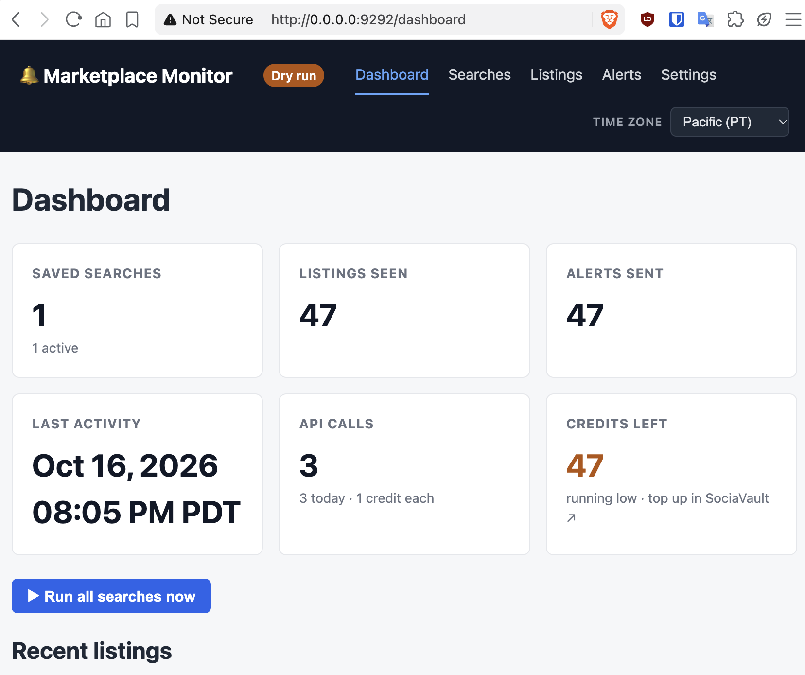

# Marketplace Monitor - Facebook Marketplace Alert System

A Ruby application that monitors Facebook Marketplace listings and sends email alerts when new items matching your search criteria are posted.

## Prerequisites

- Ruby 4.0+ (or Docker)
- SQLite3 (bundled with Docker image)
- A SociaVault API account (https://sociavault.com)
- An email account with SMTP access

## Quick start with Docker (recommended)

```bash
# 1. Copy the env template and fill in your values
cp .env.example .env
# Edit .env with your SOCIAVAULT_API_KEY, SMTP settings, and searches

# 2. Build and run (executes all saved searches once)
docker compose up

# 2b. Or start the web GUI (http://localhost:9292)
docker compose up -d web

# 3. For continuous monitoring via cron, add to crontab on the host:
# */30 * * * * cd /path/to/fbm_alerter && docker compose run --rm marketplace-monitor exec
```

### Docker commands

| Command | Description |
|---------|-------------|
| `docker compose up` | Build image, migrate DB, run all saved searches once |
| `docker compose up -d web` | Start the web GUI (http://localhost:9292) |
| `docker compose run --rm marketplace-monitor list` | List saved searches |
| `docker compose run --rm marketplace-monitor add -q bike --lat 30.2677 --long=-97.7475 --min 100 --max 500 --email you@example.com` | Add a new saved search |
| `docker compose down -v` | Stop and remove the data volume (deletes the SQLite database) |

Data persists in a Docker named volume (`marketplace-monitor-data`) mounted at `/app/storage` (SQLite file: `storage/development.sqlite3`).

### Running on Synology/QNAP NAS

Bind-mount a NAS share for the database instead of the named volume. In `docker-compose.yml`, replace:

```yaml
volumes:
  - marketplace-monitor-data:/app/storage
```

with:

```yaml
volumes:
  - /volume1/docker/fbm_alerter/data:/app/storage
```

Make sure the NAS share is writable by the container user (adjust share permissions or set `PUID`/`PGID` as needed).

## Web GUI

The app includes a Sinatra-based web GUI (no auth, intended for LAN use). It reads and writes the same SQLite database as the CLI, so a search added from either place shows up in both.



Start it with `docker compose up -d web` and visit `http://<nas-ip>:9292`.

| Page | What it shows |
|------|---------------|
| `/dashboard` | At-a-glance counts, credit balance, "Run all searches now", recent listings |
| `/searches` | Create, edit, pause/resume, delete, and run individual searches |
| `/listings` | Paginated table of every listing seen, filterable by title and sold status |
| `/alerts` | Alert history — which search matched which listing, and when it was sent |
| `/settings` | Configuration summary (secrets masked), test email, email preview |

A few things worth knowing:

- **Time zone** — the picker in the header applies to every page and is remembered for the session (Pacific by default), so timestamps read the way you expect without the container's clock mattering.
- **Dry run badge** — with `DRY_RUN=true` a "Dry run" badge appears in the header, and every search becomes a no-op: you can click around, run searches, and check the email layout without spending credits.
- **Dashboard** — every card is a link. "Credits left" is read live from SociaVault (that call is free) and turns amber once the balance gets low. "Run all searches now" streams the monitor's log onto the page, so a run is visible without watching the container. In the recent-listings table the whole row opens the ad, and the Search column links back to the search that produced it.
- **Searches** — each row can be run on its own ("Run now" shows the log inline), paused/resumed, edited, or deleted. The Calls column counts SociaVault API calls (one call = one credit) plus the date of the last run, and the Location cell shows the resolved place name with the coordinates underneath. Saving an edit forks a new search and pauses the original, so past listings keep pointing at the search that actually found them; deleting removes a search from the lists but keeps its alert and run history, so the Alerts page stays complete.
- **Listings** — thumbnails, prices, the resolved location and the search each listing came from; rows link to the Facebook ad.
- **Alerts** — send times are shown to the second, since a single run can send several alerts within the same minute.
- **Settings** — masked API key, SMTP settings, database path and environment, plus a test email form. "Preview alert email" renders the real alert template in a new tab from listings already in the database, so the layout can be checked without sending mail or spending a credit.

## Local setup (without Docker)

```bash
# 1. Install dependencies
bundle install

# 2. Copy env and configure
cp .env.example .env
# Edit .env with your API key and SMTP credentials

# 3. Run setup (migrates DB, validates config)
./setup.sh

# 4. Add searches and run
bundle exec ruby main.rb add -q bike --lat 30.2677 --long=-97.7475 --min 100 --max 500 --email you@example.com
bundle exec ruby main.rb exec
```

## Configuration

Create a `.env` file (copy from `.env.example`). Required settings:

- `SOCIAVAULT_API_KEY` — from https://sociavault.com/dashboard
- `EMAIL_FROM` — sender ("From") address for alert emails (recipients are set per saved search)
- `SMTP_ADDRESS` / `SMTP_PORT` / `SMTP_USERNAME` / `SMTP_PASSWORD` — SMTP credentials (Gmail app password recommended)

Optional:

- `DRY_RUN` — `true` to make searches a no-op: the pipeline runs but nothing is sent to SociaVault and no credits are spent. Useful for exercising the UI or checking a change without spending credits; the header shows a "Dry run" badge while it is on.

### Saved searches

Searches are stored in the SQLite database. Add them via the CLI:

```bash
bundle exec ruby main.rb add -q "mountain bike" --lat 40.7128 --long=-74.0060 --min 50 --max 300 --radius 25 --cond used_good --del shipping --email you@example.com
```

> Use `--long=-74.0060` (with `=`) for negative longitudes — a space-separated value
> starting with `-` is parsed as a command-line switch.

Each search stores its own alert recipient (`--email`), which is where notifications for that search are sent.

## Testing

```bash
bundle exec rspec
```

Integration tests mock the SociaVault API with WebMock — no real API calls are made.

## CLI commands

- `add` — Add a new saved search
- `delete ID` — Delete a saved search by ID
- `exec` — Execute all saved searches and send alerts for new listings
- `list` — List all saved searches
- `search` — Run a one-off search (not saved)
